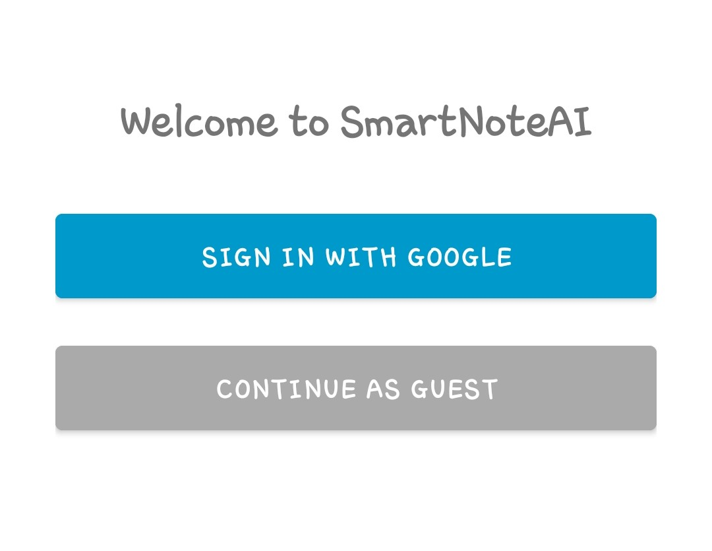
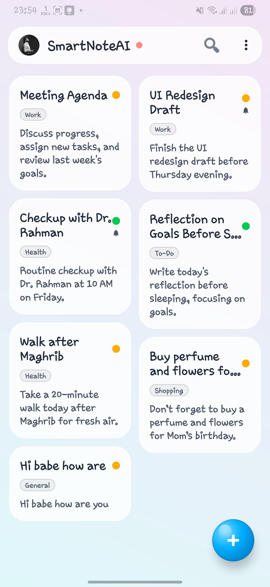
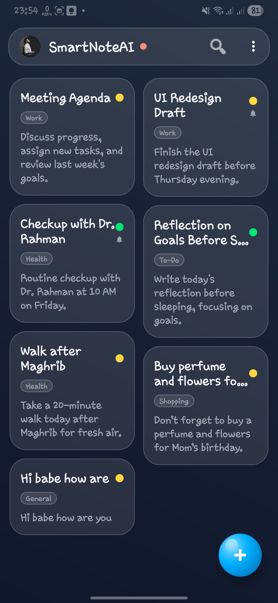
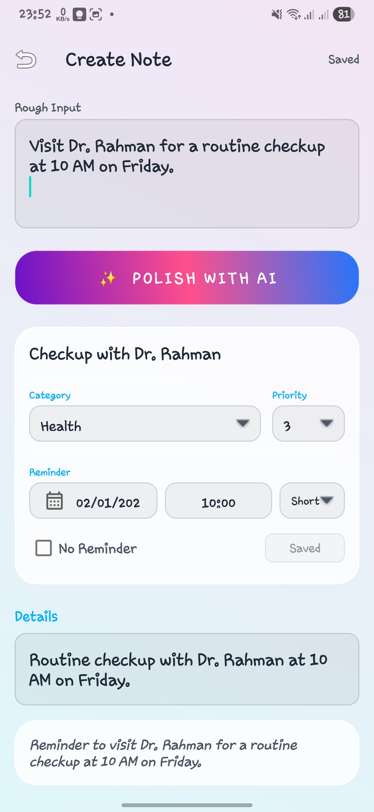
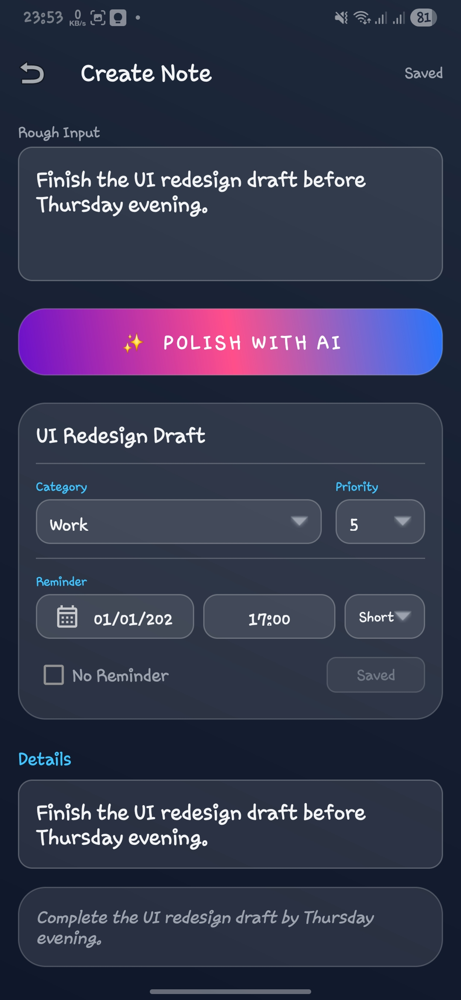

# SmartNoteAI 🚀

**SmartNoteAI** is a high-performance, secure Android application that leverages the **Gemini AI API** to transform disorganized rough notes into polished, structured content. It features end-to-end data security and real-time cloud synchronization.

## 📱 Project Overview

### Home & Authentication
*Supports Google Sign-In and a locally persistent Guest Mode.*

  

---

### Front Page (All Notes)
*Main dashboard displaying notes with pinning and category filtering.*

| Day Mode | Night Mode |
| :---: | :---: |
|  |  |

---

### Add Note Page
*The workspace where users enter rough text for AI polishing.*

| Day Mode | Night Mode |
| :---: | :---: |
|  |  |

## ✨ Key Features

* **AI-Powered Polishing:** Leverages the **Gemini API** to automatically generate titles, categories, and summaries.
* **Security:** Implements **AES-GCM 256-bit encryption** and **Biometric Lock**.
* **Precision Reminders:** Built with **AlarmManager** for accurate notifications.
* **Real-Time Sync:** Synchronizes **Room DB** with **Firebase Firestore**.

## 🛠️ Technical Stack
* **Language:** Kotlin
* **Architecture:** MVVM
* **Database:** Room & Firebase Firestore

---
**Developed by Emon Hossain Pallas** 